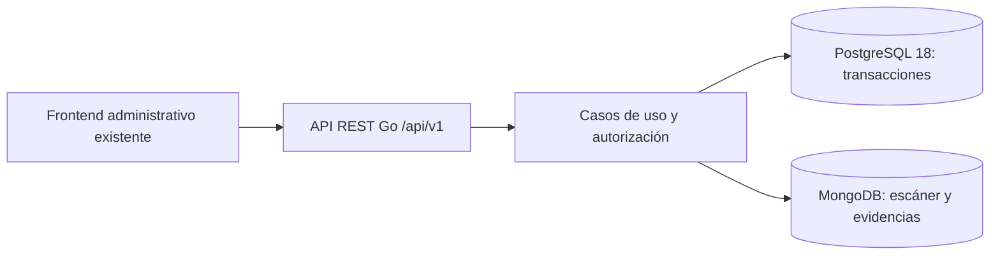

# Arquitectura del backend

> Documento inicial de arquitectura. La fase A ya está implementada con pgx,
> JWT y bcrypt; ver [FASE_A.md](FASE_A.md) para estado, configuración y límites
> actuales. Las referencias inferiores a sesiones opacas y servidor sin drivers
> describen la propuesta inicial, reemplazada por JWT según la decisión del usuario.

Preparación sobre la rama `backend/arquitectura-go-mongodb`. Repositorio:
`felixgper/elbravodeljac-sistema`. No se ejecutó el dump ni se conectó a bases.

## Distribución de responsabilidades

Monolito modular inicial: un ejecutable, casos de uso por módulo e interfaces de
repositorio solo cuando una operación las necesite. Controladores HTTP traducen
JSON/errores; aplicación orquesta reglas/transacciones; adaptadores persisten.
PostgreSQL es la autoridad de usuarios, permisos y relaciones de negocio. MongoDB
solo guarda resultados de escáner, archivos técnicos y metadatos asociados.

El servidor inicial usa únicamente la biblioteca estándar. Elegir y fijar versiones
de pgx y del controlador oficial MongoDB al implementar conexiones; no hay versiones
de dependencias aparentando estar instaladas. No se incluye Docker ni scripts que
restauren el dump sobre ElBravoDelJac. Tampoco migraciones de cambios no acordados.

## Límites transaccionales y reglas pendientes

- Alta de vehículo: vehículo + primer historial de propietario.
- Transferencia: bloquear vehículo; cerrar historial vigente, actualizar propietario
  y abrir historial verificado, todo en una transacción.
- Recepción: comprobar cliente/vehículo y kilometraje; actualizar kilometraje y
  guardar recepción atómicamente. Conservar cliente de la atención histórica.
- Diagnóstico: recepción única y técnico derivado del actor autorizado.
- Cotización: cabecera + detalles + total recalculado con decimal exacto; exactamente
  una referencia servicio/repuesto por línea; repuesto del cliente sin cobro.
- Crear OT: bloquear cotización aprobada, impedir una segunda OT y generar código
  sin max(id)+1; insertar asignaciones e historial inicial atómicamente.
- Actualizar OT: avance, prueba opcional, cambios de asignaciones y estado en una
  transacción. Finalizar exige prueba satisfactoria posterior a la última reparación.
- Pagos/entregas: bloquear la misma OT, recalcular total/pagos, impedir sobrepago;
  entregar solo finalizada, sin saldo y con identidad/autorización verificadas.
- Eliminaciones: respetar FK y devolver 409 cuando hay dependencias. No aplicar
  cascadas destructivas ni inventar columnas activo en tablas que no las tienen.
  Conservar OT con pagos/entrega y todo su historial.
- Usuarios/permisos: impedir bloqueo del último administrador y conservar el
  acceso obligatorio del Propietario. Aplicar control a cada objeto, no solo menú.

El dump contiene triggers de cotización aprobada y entrega validada. No garantiza
por sí solo sobrepagos concurrentes, kilometraje monótono, prueba final ni todas
las reglas anteriores. Las restricciones actuales se respetan y complementan en Go.

## Identidad y autorización

Propuesta: sesión opaca de servidor, cookie HttpOnly/Secure/SameSite y protección
CSRF para escrituras. Servir frontend y API desde el mismo origen al integrar.
Persistencia/expiración/revocación de sesiones aún por implementar; las 26 tablas
no incluyen sesiones. No almacenar sesiones en las colecciones técnicas MongoDB.
Si se necesita tabla de sesiones, preparar una migración separada y revisada.
Contraseñas con hash adaptativo y sal por usuario; jamás copiar el SHA-256 demo
como autenticación de producción. password_hash nunca sale por la API ni registros.

Catálogo `modulo.accion` alineado con data/permissions.js, persistido en permisos y
rol_permisos. Reconciliar roles reales con los seis roles demo; no sembrar ni
sobrescribir roles existentes. Cada petición obtiene actor desde sesión verificada,
no desde id_usuario enviado por el navegador. Las tareas se filtran por el actor.

## PostgreSQL y MongoDB

No existe una transacción compartida entre ambos motores en esta propuesta.
Crear primero diagnóstico en PostgreSQL y después documentos técnicos mediante
operaciones separadas y reintentables. Un fallo MongoDB conserva el diagnóstico
guardado y se informa como 503; no se simula éxito ni se borra la atención.

Usar requestId único por diagnóstico y colección para deduplicar reintentos.
Verificar SQL antes de guardar y al leer; restringir eliminación de diagnósticos
con referencias documentales (no se ofrece DELETE de diagnóstico). Reconciliación
periódica futura identifica huérfanos. Si aparece necesidad de sincronización
automática, proponer outbox como migración futura; no existe en el esquema actual.

Para binarios se propone GridFS con metadatos en evidencias_tecnicas. Upload:
archivo temporal/cuarentena, validar tipo/tamaño y persistir metadatos; si falla
el segundo paso, limpiar el archivo y reconciliar restos. No usar URLs públicas
ni rutas del cliente. Límite inicial propuesto: 10 MiB, PDF/JPEG/PNG; validar
contenido además de extensión. El frontend actual no tiene carga de evidencias:
su interfaz se acordará después sin alterar las pantallas en esta preparación.

## Orden de implementación

1. Resolver diferencias de CORRESPONDENCIA.md y revisar los valores existentes
   con consultas de solo lectura autorizadas. El dump es estructural, no inventario
   de catálogos ni confirmación del contenido vivo.
2. Configurar entornos privados y bases de pruebas separadas; instalar y fijar
   drivers, pool, timeouts y cierre ordenado. No restaurar sobre la base existente.
3. Implementar acceso, sesiones, permisos y mapeo de errores; después clientes,
   vehículos y catálogos con pruebas de integración en base descartable.
4. Implementar recepción → diagnóstico → cotización → OT → pagos → entrega,
   con pruebas de concurrencia y transacciones; luego auxilios y consultas.
5. Implementar MongoDB/GridFS y sus validadores/índices mediante tarea explícita
   contra el entorno de pruebas; probar reintentos y fallos entre motores.
6. Integrar servicios HTTP del frontend con await, carga/errores y pruebas del
   recorrido completo. No basta cambiar getStore por fetch: las vistas usan
   lecturas síncronas y arreglos locales en varios puntos. Mantener demo disponible.

## Fuentes técnicas

- [Organización de módulos Go](https://go.dev/doc/modules/layout): cmd e internal.
- [Bloqueos PostgreSQL 18](https://www.postgresql.org/docs/18/explicit-locking.html):
  referencia para serializar operaciones concurrentes sobre la misma orden.
- [Transacciones MongoDB](https://www.mongodb.com/docs/manual/core/transactions/):
  alcance de atomicidad dentro de MongoDB; no equivale a atomicidad con PostgreSQL.
